<div align="center">

# crypt-lib

**Учебная криптографическая библиотека на чистом Python**

От битов и S-блоков до AES, «Кузнечика», SHA-3, Стрибога, RSA и ГОСТ-подписи:
каждый алгоритм написан с нуля, прокомментирован и сверен с эталонными векторами стандартов.


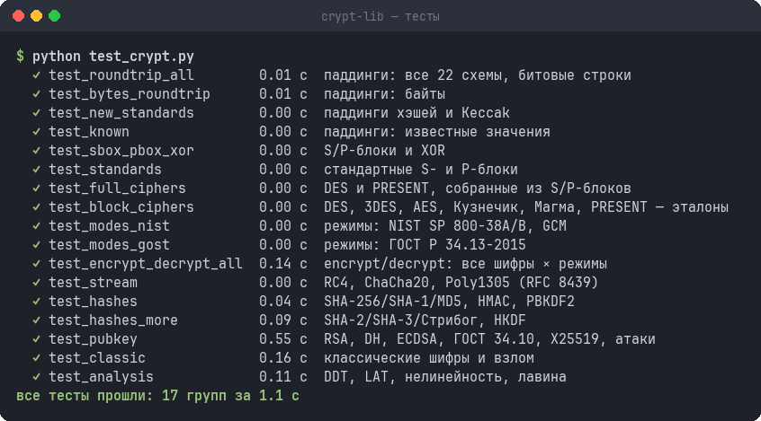

</div>

> [!WARNING]
> Библиотека создана **для обучения, лабораторных работ и экспериментов**. В ней нет защиты
> от атак по времени и сторонним каналам, а ключи хранятся в обычных `int` и `bytes`.
> Для защиты реальных данных используйте [`cryptography`](https://cryptography.io) или libsodium.

---

## Содержание

- [Возможности](#возможности)
- [Установка](#установка)
- [Быстрый старт](#быстрый-старт)
- [Архитектура](#архитектура)
- [Модули](#модули)
  - [Биты и дополнение — `bits`, `padding`](#1-биты-и-дополнение--bits-padding)
  - [S-блоки, P-блоки, XOR — `sbox`, `pbox`, `xor`](#2-s-блоки-p-блоки-xor--sbox-pbox-xor)
  - [Блочные шифры — `ciphers`](#3-блочные-шифры--ciphers)
  - [Режимы работы — `modes`](#4-режимы-работы--modes)
  - [Потоковые шифры — `stream`](#5-потоковые-шифры--stream)
  - [Хэши, MAC и выработка ключей — `hashes`](#6-хэши-mac-и-выработка-ключей--hashes)
  - [Асимметричная криптография — `pubkey`](#7-асимметричная-криптография--pubkey)
  - [Классические шифры и их взлом — `classic`](#8-классические-шифры-и-их-взлом--classic)
  - [Анализ стойкости — `analysis`](#9-анализ-стойкости--analysis)
- [Проверка по стандартам](#проверка-по-стандартам)
- [Структура проекта](#структура-проекта)
- [Авторы](#авторы)
- [Как цитировать](#как-цитировать)
- [Лицензия](#лицензия)

---

## Возможности

| Область | Что реализовано |
|---|---|
| **Дополнение** | 22 схемы: PKCS#7/5, ANSI X9.23, ISO 10126, ISO 7816-4, ISO 9797-1, ГОСТ 34.13 (процедуры 1–3), TLS, SSL 3, ESP, PKCS#1 v1.5, MD-усиление, Keccak pad10\*1, SHA-3/SHAKE, Стрибог |
| **Блочные шифры** | DES, 3DES, AES-128/192/256, «Магма», «Кузнечик», PRESENT-80/128, конструкторы сетей Фейстеля и SP-сетей |
| **Режимы** | ECB, CBC, PCBC, CFB (вкл. CFB-8), OFB, CTR (NIST и ГОСТ), GCM, CMAC (имитовставка ГОСТ), CBC-MAC |
| **Потоковые** | RC4, ChaCha20, Poly1305, AEAD ChaCha20-Poly1305 |
| **Хэши** | MD5, SHA-1, SHA-224/256/384/512, SHA-512/224, SHA-512/256, SHA3-224/256/384/512, SHAKE128/256, Keccak-256, Стрибог-256/512 |
| **MAC и KDF** | HMAC (с любым хэшем, в т. ч. HMAC-Стрибог), PBKDF2, HKDF |
| **Асимметричные** | RSA (OAEP, PKCS#1 v1.5, PSS), Диффи–Хеллман (группы RFC 3526), Эль-Гамаль, ECDH и ECDSA (P-256, secp256k1), ГОСТ Р 34.10-2012, X25519 |
| **Атаки** | малый показатель RSA, атака Хостада, общий модуль, атака Винера, повтор `k` в ECDSA, повтор nonce и подмена битов в потоковых шифрах, взлом Цезаря, аффинного шифра и Виженера |
| **Анализ** | DDT, LAT, дифференциальная равномерность, нелинейность, алгебраическая степень, лавинный эффект, SAC, энтропия |
| **Классика** | Цезарь, ROT13, Атбаш, аффинный, простая замена, Виженер, Бофор, самоключ, Хилл, «изгородь», столбцовая перестановка |

**Принципы:**

- **Без зависимостей.** Только стандартная библиотека Python. Пакет `cryptography` нужен лишь тестам, чтобы сверять результаты.
- **Читаемость важнее скорости.** Код повторяет формулы стандартов, константы вычисляются там, где это возможно: константы SHA-2 — из корней простых чисел, Keccak — через LFSR, группы Диффи–Хеллмана — из числа π.
- **Проверка по эталонам.** Каждый алгоритм проверяется контрольными примерами из своего стандарта (см. [таблицу](#проверка-по-стандартам)).
- **Единый вход.** Данные можно передавать как `bytes`, как текст (берётся UTF-8) или как строку битов `"1101"`. Строка битов на входе даёт строку битов на выходе.

---

## Установка

```bash
pip install git+https://github.com/Akurochek/crypt-lib.git
```

Для разработки:

```bash
git clone https://github.com/Akurochek/crypt-lib.git && cd crypt-lib
pip install cryptography        # только для сверки в тестах
python test_crypt.py            # все тесты, около секунды
python examples/ex_pubkey.py    # любой пример из examples/
```

Требуется Python 3.10+. Пакет импортируется как `crypto_enu`. В Python до 3.12 включительно
есть встроенный модуль `crypt` (на Windows он сразу падает с ImportError), поэтому имя `crypt` занимать нельзя.
В примерах используется сокращение `import crypto_enu as crypt`.

---

## Быстрый старт

```python
import crypto_enu as crypt     # не «import crypt»: так называется модуль стандартной библиотеки

# Симметричное шифрование: шифр + режим + паддинг одной строкой
key = bytes(32)
ct = crypt.encrypt(b"secret", key, "kuznyechik", "cbc")       # IV в начале, PKCS#7
crypt.decrypt(ct, key, "kuznyechik", "cbc")                    # b'secret'
crypt.encrypt(b"secret", key[:16], "aes", "gcm", aad=b"hdr")   # nonce + шифртекст + тег

# ГОСТ: гаммирование и имитовставка
m = crypt.Magma(key)
crypt.ctr(m, b"data", b"\x12\x34\x56\x78")                     # IV на полблока
crypt.cmac(m, b"data", 4)                                      # имитовставка, 32 бита

# Хэши и ключи
crypt.sha3_256(b"abc").hex()
crypt.streebog256("Привет".encode()).hex()
crypt.hkdf(b"shared secret", 32, salt=b"salt", info=b"app key")

# Асимметричная криптография
pub, priv = crypt.rsa_keygen(2048)
crypt.rsa_oaep_decrypt(crypt.rsa_oaep_encrypt(b"hi", pub), priv)   # b'hi'
d, Q = crypt.ec_keygen("gost_test")
sig = crypt.gost_sign(b"document", d)
crypt.gost_verify(b"document", sig, Q)                             # True

# Взлом и анализ
crypt.crack_caesar(crypt.caesar("Атака на рассвете у старого моста", 7))   # (7, 'Атака на рассвете у…')
crypt.sbox_report("aes")    # {'nonlinearity': 112, 'differential_uniformity': 4, ...}
```

---

## Архитектура

Модули выстроены слоями: каждый следующий собирается из предыдущих. Например, AES состоит
из S-блока `sbox` и XOR, SHA-256 использует паддинг `"sha2"` из `padding`, а RSA-подпись — схему `"pkcs1_t1"`.

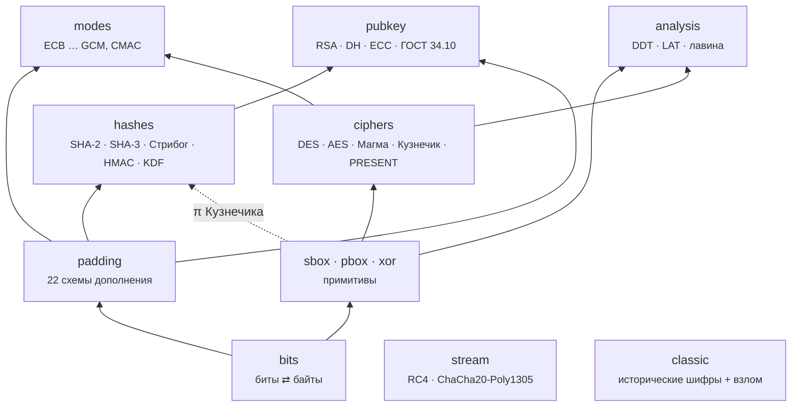

---

## Модули

### 1. Биты и дополнение — `bits`, `padding`

Блочный шифр обрабатывает данные порциями фиксированной длины. Если сообщение короче, его
**дополняют** по правилу, которое позволяет однозначно убрать дополнение после расшифровки.
Каждая схема работает и с байтами, и с произвольными строками битов. По каждой можно
получить справку: из какого она стандарта и как устроена.

```python
crypt.pad(b"AB", 32, "pkcs7")        # b'AB\x02\x02'
p = crypt.pad128("10110")            # '10110' + '1' + '0'*122  (ISO 7816-4 / ГОСТ процедура 2)
crypt.unpad(p, 128, "gost_p2")       # '10110'; алиас: gost_p2 = iso7816_4
crypt.info("pkcs1_t2")               # 'pkcs1_t2: 00 02 <случайные ненулевые> 00 M … Стандарт: RFC 8017 …'
```

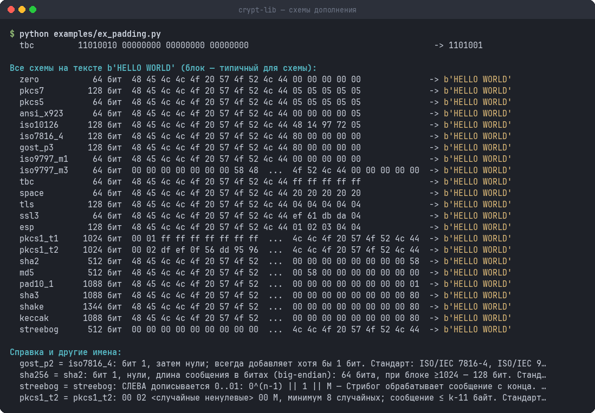

### 2. S-блоки, P-блоки, XOR — `sbox`, `pbox`, `xor`

Из этих кирпичиков строится любой современный блочный шифр:

- **S-блок** (подстановка) вносит нелинейность: таблица «вход → выход»;
- **P-блок** (перестановка) рассеивает биты по блоку;
- **XOR** смешивает данные с ключом.

В библиотеке есть стандартные таблицы AES, «Кузнечика», «Магмы», PRESENT, GIFT, DES,
а также P-блоки DES и PRESENT.

```python
crypt.sbox("11010010", "aes")                    # подстановка над строкой битов
crypt.pbox("1101", [3, 2, 1, 0])                 # '1011'
crypt.xor(b"\x0f\xf0", b"\xff\xff")              # b'\xf0\x0f'
```

`examples/ex_standards.py` собирает **DES и PRESENT целиком из этих блоков** и получает
эталонные шифртексты из стандартов.

### 3. Блочные шифры — `ciphers`

| Шифр | Блок | Ключ | Структура | Стандарт |
|---|---|---|---|---|
| `DES` / `TDES` | 64 | 56 / 168 | сеть Фейстеля, 16 раундов | FIPS 46-3 |
| `AES` | 128 | 128/192/256 | SP-сеть, 10–14 раундов | FIPS 197 |
| `Magma` | 64 | 256 | сеть Фейстеля, 32 раунда | ГОСТ Р 34.12-2015 |
| `Kuznyechik` | 128 | 256 | SP-сеть + линейный слой над GF(2⁸), 10 раундов | ГОСТ Р 34.12-2015 |
| `Present` | 64 | 80/128 | облегчённая SP-сеть, 31 раунд | ISO/IEC 29192-2 |
| `Feistel`, `SPN` | любой | любой | собственная конструкция | — |

```python
c = crypt.AES(key16)                   # или crypt.cipher("aes", key16)
c.encrypt_block(b"16 byte block!!!")
my = crypt.SPN([os.urandom(8) for _ in range(9)], sbox="present", perm="present")  # своя SP-сеть
```

### 4. Режимы работы — `modes`

Режим определяет, как шифровать сообщения длиннее одного блока. ГОСТ-названия указаны в `crypt.MODES`.

| Режим | Что делает | Паддинг | Аутентичность |
|---|---|:-:|:-:|
| ECB | каждый блок независимо — **виден рисунок данных** | да | — |
| CBC, PCBC | сцепление с предыдущим блоком | да | — |
| CFB, OFB, CTR | превращают блочный шифр в потоковый | нет | — |
| GCM | CTR + GHASH (AEAD) | нет | ✓ |
| CMAC, CBC-MAC | имитовставка | — | ✓ |

Почему ECB нельзя использовать для данных со структурой: одинаковые блоки открытого текста
дают одинаковые блоки шифртекста. Картинка ниже зашифрована библиотекой на AES-128
в двух режимах (`tools/make_images.py`):

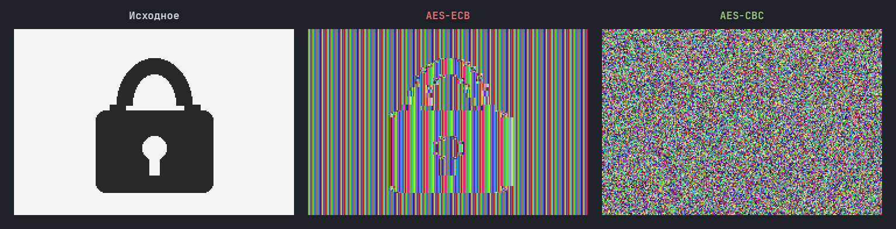

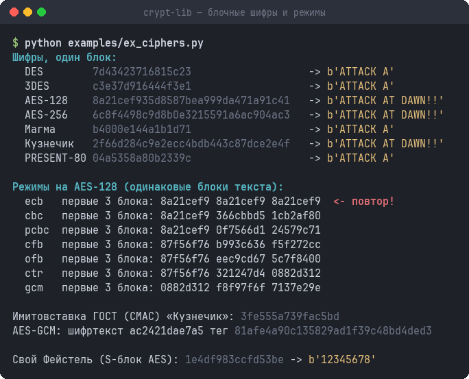

### 5. Потоковые шифры — `stream`

Потоковый шифр растягивает ключ и nonce в псевдослучайную **гамму** и складывает её с текстом по XOR.
Шифрование и расшифрование — одна и та же операция.

| Функция | Назначение |
|---|---|
| `rc4`, `rc4_keystream(…, drop=768)` | исторический RC4 (WEP, старый TLS); **сломан**, оставлен для изучения |
| `chacha20` | современный ARX-шифр (TLS 1.3, SSH, WireGuard) |
| `poly1305` | одноразовый MAC: многочлен по модулю 2¹³⁰ − 5 |
| `chacha20_poly1305_encrypt/decrypt` | AEAD по RFC 8439: шифрование + целостность + AAD |

Две главные ошибки при работе с гаммой показаны в `examples/ex_stream_attacks.py`. Первая —
**повтор nonce**: `C1 ⊕ C2 = P1 ⊕ P2`. Вторая — **отсутствие MAC**: противник переворачивает
биты шифртекста и тем самым меняет открытый текст.

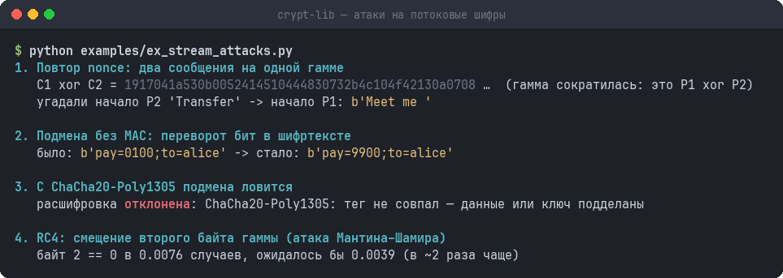

### 6. Хэши, MAC и выработка ключей — `hashes`

| Семейство | Функции | Конструкция |
|---|---|---|
| MD5, SHA-1 | `md5`, `sha1` | Меркл–Дамгор (оба **сломаны**, только для учёбы) |
| SHA-2 | `sha224`, `sha256`, `sha384`, `sha512`, `sha512_224`, `sha512_256` | Меркл–Дамгор, 32- и 64-битные слова |
| SHA-3 | `sha3_224/256/384/512`, `shake128`, `shake256`, `keccak256` | губка на перестановке Keccak-f[1600] |
| Стрибог | `streebog256`, `streebog512`, `streebog(data, bits)` | ГОСТ Р 34.11-2012, сжатие на 12 раундах LPSX |
| MAC / KDF | `hmac(key, msg, hash)`, `pbkdf2`, `hkdf` | RFC 2104, RFC 8018, RFC 5869 |

Хэши используют паддинги из `padding`. Например, SHA-512 — это `pad(data, 1024, "sha2")`,
а SHA-3 — `pad(data, rate, "sha3")`. Всё семейство SHA-2 и SHA-3 побайтно совпадает с `hashlib`,
Стрибог — с контрольным примером стандарта.

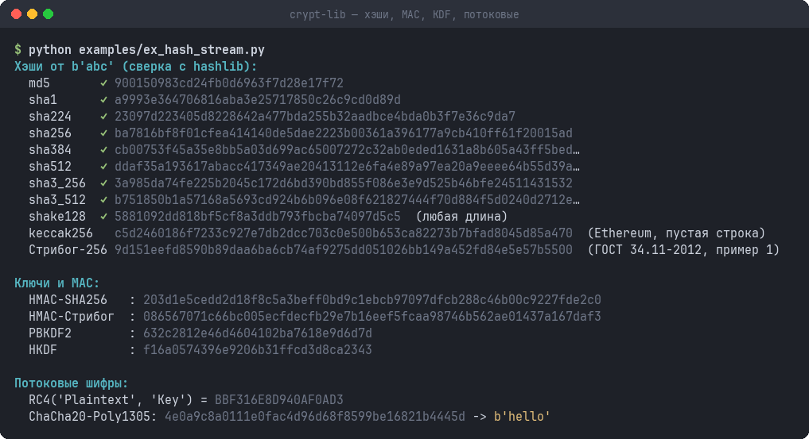

### 7. Асимметричная криптография — `pubkey`

Ключи хранятся как обычные числа и именованные кортежи, чтобы математика оставалась на виду.

**Теория чисел:** `egcd`, `modinv`, `crt` (китайская теорема об остатках), `is_prime` (Миллер–Рабин), `gen_prime`.

| Схема | Функции | Стандарт |
|---|---|---|
| RSA | `rsa_keygen`, `rsa_oaep_encrypt/decrypt`, `rsa_pkcs1_encrypt/decrypt`, `rsa_pkcs1_sign/verify`, `rsa_pss_sign/verify`, «учебные» `rsa_encrypt_int/decrypt_int` (с КТО) | RFC 8017 |
| Диффи–Хеллман | `modp_group(2048)`, `dh_keygen`, `dh_shared` | RFC 3526 |
| Эль-Гамаль | `elgamal_encrypt`, `elgamal_decrypt` | — |
| Эллиптические кривые | `CURVES` (`p256`, `secp256k1`, `gost_test`), `ec_add`, `ec_mul`, `ec_keygen`, `ecdh` | SEC 1, FIPS 186 |
| ECDSA | `ecdsa_sign`, `ecdsa_verify` | FIPS 186-5 |
| ГОСТ-подпись | `gost_sign`, `gost_verify` (хэш — Стрибог) | ГОСТ Р 34.10-2012 |
| X25519 | `x25519(k)` — открытый ключ, `x25519(k, u)` — общий секрет | RFC 7748 |

**Атаки на неправильное использование:**

| Функция | Ошибка | Последствие |
|---|---|---|
| `rsa_small_e_attack` | `e = 3`, нет паддинга, короткое `m` | `m = ∛c` |
| `rsa_hastad` | одно сообщение для `e` получателей | восстановление `m` по КТО |
| `rsa_common_modulus` | один `n` с разными `e` | `m` без закрытого ключа |
| `rsa_wiener` | маленький `d < n^¼/3` | `d` из цепной дроби `e/n` |
| `ecdsa_recover_key` | повтор `k` в двух подписях | закрытый ключ (так взломали PS3) |

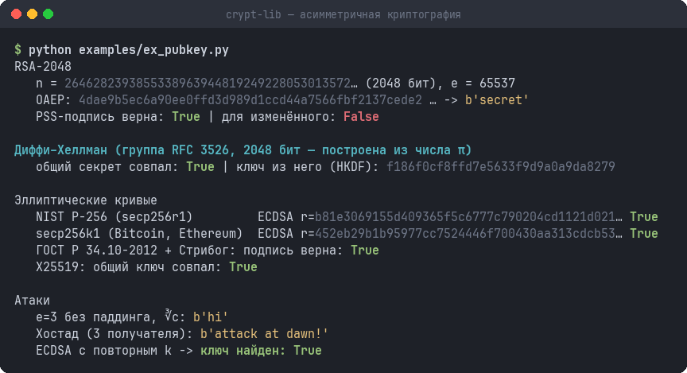

### 8. Классические шифры и их взлом — `classic`

Шифры работают с русским и английским алфавитом (определяется автоматически) и сохраняют
регистр и знаки препинания.

- **Шифры:** `caesar`, `rot13`, `atbash`, `affine`, `substitution`, `vigenere`, `beaufort`, `autokey`, `hill`, `rail_fence`, `columnar`.
- **Криптоанализ:** `frequencies`, `index_of_coincidence`, `chi_squared`, `kasiski`, `vigenere_key_length`.
- **Автоматический взлом:** `crack_caesar`, `crack_affine`, `crack_vigenere`.

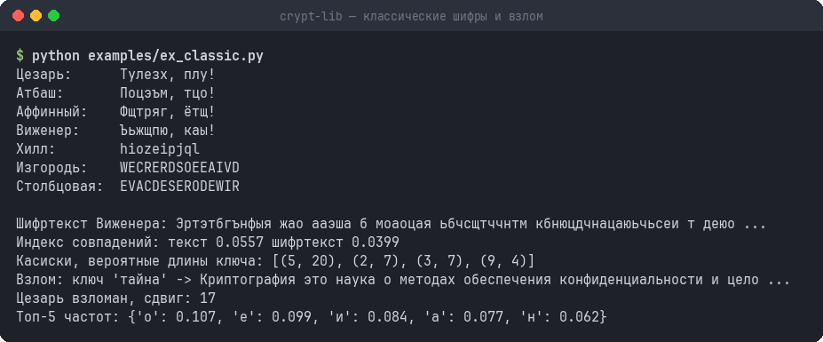

### 9. Анализ стойкости — `analysis`

Модуль проверяет свойства, которые защищают шифр от известных атак.

| Функция | Что измеряет | Защищает от |
|---|---|---|
| `ddt`, `differential_uniformity` | как часто разность входов `a` даёт разность выходов `b` | дифференциального анализа |
| `lat`, `nonlinearity` | расстояние до ближайшей линейной функции (через Уолша–Адамара) | линейного анализа |
| `algebraic_degree` | степень многочлена Жегалкина (преобразование Мёбиуса) | алгебраических атак |
| `avalanche`, `sac_matrix` | доля выходных битов, меняющихся при смене одного входного | статистических атак |
| `entropy` | энтропия Шеннона в битах на байт | — |
| `sbox_report` | всё сразу + биективность, инволюция, неподвижные точки | — |

Таблица DDT наглядно показывает, чем хороший S-блок отличается от плохого. У AES любая
разность выходов встречается не более 4 раз из 256, у слабого блока разность полностью предсказуема:

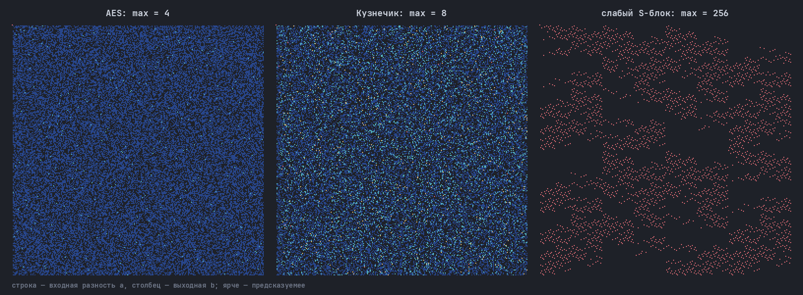

Лавинный эффект растёт с числом раундов. Это объясняет, почему шифрам нужно много раундов:

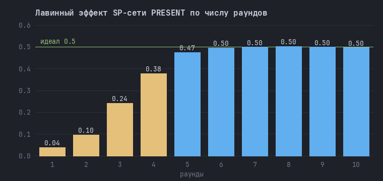

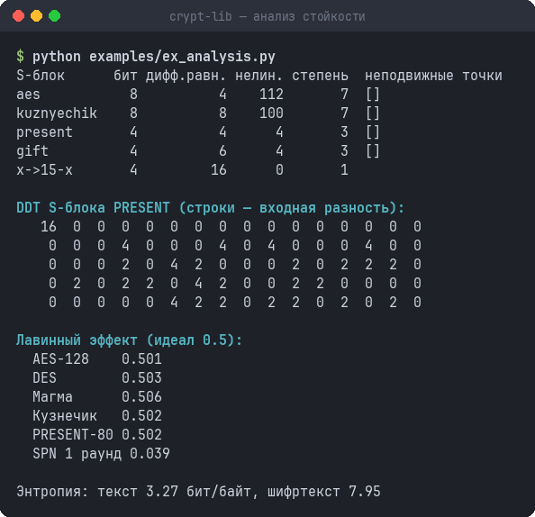

---

## Проверка по стандартам

Тесты проверяют библиотеку на контрольных примерах из стандартов, а там, где это возможно, —
побайтной сверкой с `hashlib` и `cryptography` в обе стороны.

| Алгоритм | Источник эталона |
|---|---|
| DES, 3DES | FIPS 46-3 |
| AES-128/192/256 | FIPS 197, приложение C |
| «Магма», «Кузнечик», CTR, имитовставка | ГОСТ Р 34.12-2015, ГОСТ Р 34.13-2015, приложение А |
| PRESENT-80/128 | статья авторов PRESENT (CHES 2007) |
| ECB, CBC, CFB, OFB, CTR | NIST SP 800-38A |
| CMAC / GCM | RFC 4493 / McGrew–Viega |
| ChaCha20, Poly1305 | RFC 8439 |
| SHA-1, SHA-2, SHA-3, SHAKE, HMAC, PBKDF2 | сверка с `hashlib` на граничных длинах |
| Стрибог-256/512 | ГОСТ Р 34.11-2012, контрольный пример 1 |
| HKDF | RFC 5869, тест 1 |
| RSA OAEP / PKCS#1 v1.5 / PSS | взаимная проверка с `cryptography` |
| ECDSA, ECDH (P-256, secp256k1) | взаимная проверка с `cryptography` |
| ГОСТ Р 34.10-2012 | контрольный пример приложения А.1 (ключ, `r`, `s`) |
| X25519 | RFC 7748, раздел 6.1 |
| Группы Диффи–Хеллмана | RFC 3526 (простое число строится из π и совпадает со стандартом) |

---

## Структура проекта

```
crypt-lib/
├── crypto_enu/             пакет (импорт: import crypto_enu as crypt)
│   ├── bits.py             биты ⇄ байты
│   ├── padding.py          22 схемы дополнения
│   ├── sbox.py  pbox.py  xor.py
│   ├── ciphers.py          DES, AES, Магма, Кузнечик, PRESENT, Feistel, SPN
│   ├── modes.py            ECB … GCM, CMAC, encrypt/decrypt
│   ├── stream.py           RC4, ChaCha20, Poly1305
│   ├── hashes.py           SHA-2, SHA-3, Стрибог, HMAC, PBKDF2, HKDF
│   ├── pubkey.py           RSA, DH, Эль-Гамаль, ECC, ECDSA, ГОСТ 34.10, X25519, атаки
│   ├── classic.py          классические шифры и криптоанализ
│   └── analysis.py         DDT, LAT, нелинейность, лавина
├── examples/               примеры по модулям (ex_*.py)
├── tools/make_images.py    генерация картинок для README
├── docs/img/               скриншоты и иллюстрации
├── test_crypt.py           тесты (python test_crypt.py)
└── demo.py                 короткая демонстрация битовых операций
```

Все картинки в README сгенерированы из настоящего вывода библиотеки командой
`python tools/make_images.py` (нужен Pillow).

---

## Авторы

| | Автор |
|---|---|
| 1 | **Мукашев Асет** |
| 2 | **Мырзабеков Ерасыл** |
| 3 | **Гадаев Алишер** |
| 4 | **Рахимжанова Зарина** |

Полный список — в [AUTHORS.md](AUTHORS.md). История версий — в [CHANGELOG.md](CHANGELOG.md),
правила участия — в [CONTRIBUTING.md](CONTRIBUTING.md).

---

## Как цитировать

```
Мукашев А., Мырзабеков Е., Гадаев А., Рахимжанова З. crypt-lib: учебная криптографическая
библиотека на Python [Электронный ресурс]. — Версия 0.2.1. — 2026. —
URL: https://github.com/Akurochek/crypt-lib
```

Машиночитаемая ссылка — [CITATION.cff](CITATION.cff) (кнопка «Cite this repository» на GitHub).

---

## Лицензия

MIT — см. [LICENSE](LICENSE). © 2026 Мукашев Асет, Мырзабеков Ерасыл, Гадаев Алишер, Рахимжанова Зарина.
